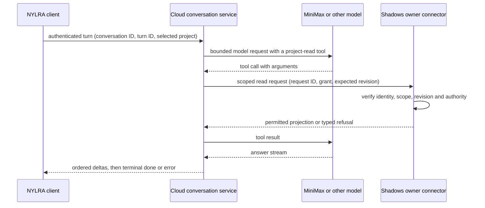

# J1 Linux cross-project probe (2026-10-12)

Probe source: `probes/j1-linux-2026-10-12/` at `7fc59a7`, tagged
`probe/2026-10-12-linux-integration`. It was not merged; this file keeps its
findings. Sections below are the probe's own records, unchanged except for
heading nesting and links replaced with historical paths.

## RESULTS

All content used below was disposable: Shadows project
`63e24e0a-f587-4518-b389-d45a7f93cc4a`, named **Synthetic Lighthouse**,
whose README says it is a cross-project integration fixture. The MiniMax key
was supplied only at runtime and is absent from these repositories.

### Observed

| Scenario | Result | Evidence / meaning |
| --- | --- | --- |
| AI SDK `6.0.303` + `@ai-sdk/openai` `3.0.125`, MiniMax `MiniMax-M3`, mandatory selected-project tool, local Shadows owner available | Completed: two text delta events, fixture name present, one tool execution, two model steps | A real provider call and Shadows owner read crossed the standalone backend probe. The HTTP client saw `done`. |
| Tool requests a different UUID | Refused before any owner HTTP request | `selected-project.test.mjs` verifies the fixed selected-project boundary. |
| Shadows owner unavailable | Failed after tool error; no successful completion | The first live run exposed AI SDK's `tool-error` stream part: it had incorrectly produced `done`. Regression test and `forwardProbePart` now reject it. Repeated live run produced `failed=true`, `completed=false`, zero delta events. |
| NYLRA Linux preview client | SSE parser tests passed; Vite served the preview and approved AYLUL idle asset; native Tauri window rendered AYLUL and displayed a completed local SSE fixture after a button click | That native click used a deterministic fixture, not this real MiniMax probe. See the NYLRA evidence. |
| Native Linux webview origin | Local `tauri://localhost` accepted; unrecognized browser origin refused before conversation | The original Vite-only CORS allowlist returned 403 to the native webview. Regression tests now cover both sides; a native click-through still needs a UI run. |

`npm test` currently exercises thirteen probe tests. These results cover a
synthetic, same-host exchange; they do not exercise a cloud-to-private-machine
network path, identity, owner grant, state persistence, or cancellation.

### Follow-up native window experiments

The real native NYLRA click reached the backend/provider request, but MiniMax
returned explicit Token Plan usage-limit evidence (`2067`,
`insufficient_balance_error`). The UI reported unavailable/incomplete; it did
not show a completed answer. This result is specific to that MiniMax request.
AI SDK's default error callback also printed the raw error/request; the probe
now overrides that callback, and a regression test proves a rejected provider
request emits no raw console error and no `done`.

An alternative native run used `provider-fixture.mjs` to simulate only the
provider's OpenAI-compatible SSE responses. The rest was real: a new Shadows
daemon/database, owner API, AI SDK tool execution, backend HTTP/SSE, rebuilt
Tauri window and `eventsource-parser`. It completed with one owner tool call,
two SDK steps, 20 text characters, and native `Complete` + fixture name visible.
The fixture's reply name is read from the actual owner tool result; it refuses
to reply without that result. No remote provider is exercised by this run.

The OpenRouter attempt remains a separate network failure: Envoy refused the
HTTPS CONNECT with 403 before reaching the provider. After the user reported
adding the domain, a repeated credential-free request still received CONNECT
403 and the current enforced policy still omitted `openrouter.ai`. See
OPENROUTER.md (`probes/j1-linux-2026-10-12/OPENROUTER.md` at `7fc59a7`); neither key validity nor free-model quota has
been established. See LIBRARIES.md (`probes/j1-linux-2026-10-12/LIBRARIES.md` at `7fc59a7`) for inspected SDK/parser and
transport options.

### What should become the product boundary



The cloud backend should own provider credentials, SDK integration, turn state,
and stream delivery. Shadows should remain the authority for local project
data and actions. NYLRA should render the stream and collect user decisions;
its UI should not be the connector. A cloud server cannot directly use the
loopback address of a user's machine. The next experiment should have Shadows
establish an authenticated outbound connection (or poll a durable work queue)
and correlate requests and replies by stable IDs. Compare those transports
under disconnect/reconnect before choosing one.

Use a versioned conversation API with explicit `delta`, `done`, `error`, and
`cancelled` terminal semantics; persist only according to an agreed retention
policy. Every tool request needs a selected-project grant and owner-side
recheck. Provider tool arguments and model prose carry no authorization. The
current probe's `GET /api/projects` reads the entire list before local
filtering, which must be replaced by an owner-enforced, scoped projection.

### Reproduce safely

Follow README.md (`probes/j1-linux-2026-10-12/README.md` at `7fc59a7`). Use a new disposable project and local
`SHADOWS_PROJECT_ID`; run `npm ci && npm test` before `npm start`. Set
`MINIMAX_API_KEY` only in the process environment. On a managed proxy, use
`NODE_USE_ENV_PROXY=1` and the provided proxy/CA environment. Stop Shadows to
reproduce the terminal error case. No production credentials or user projects
are needed.

## OPENROUTER

The user authorized a temporary OpenRouter key and free models only. The key
was passed through non-echoing stdin to one Node process, never written to a
repository, environment file, Docker image or output log.

### Current observed boundary

The authenticated discovery attempt did not reach OpenRouter. A subsequent
credential-free `curl --head https://openrouter.ai/api/v1/models` returned
`CONNECT tunnel failed, response 403` from the managed environment's Envoy
proxy. The current environment status reported an **enforced restricted**
network policy with `api.minimax.io` allowed; `openrouter.ai` was absent from
the effective allowed hosts. This is a network-policy refusal before TLS and
the provider API. It establishes neither key validity nor free-model availability
or quota exhaustion. No free OpenRouter model result is claimed yet.

The environment's supported configuration workflow must add `openrouter.ai`
before retrying. The runtime tool here can read policy, not change it. Proxy
bypasses or alternate relays are not valid ways to test the blocked destination.

### Prepared diagnostic

`openrouter-discovery.mjs` authenticates at `/api/v1/key`, obtains the live
model catalog, filters `:free` IDs with zero prompt/completion prices, and
attempts up to three advertised tool-capable free models using a tiny synthetic
prompt. Each call is capped at 256 output tokens and 30 seconds. It prints only
safe statuses, model IDs, counts/booleans, finish reasons and classified failures.
It does not persist response text. Paid models are never selected.

On a permitted Linux network, from this directory:

```bash
read -r -s -p 'Temporary OpenRouter key: ' probe_router_key
printf '%s\n' "$probe_router_key" | NODE_USE_ENV_PROXY=1 node openrouter-discovery.mjs
unset probe_router_key
```

Preserve the managed proxy and CA settings. Do not enable shell tracing.

### Do not collapse different failures into quota

- A proxy CONNECT refusal is a transport/policy failure; there is no provider
  HTTP status to classify.
- HTTP 401 establishes authentication rejection; HTTP 402 establishes a credit
  requirement. HTTP 429 alone establishes rate limiting with an unknown window.
- Only explicit daily/free-limit evidence is classified as daily/free quota.
- Unavailable endpoints, rejected parameters, upstream failure, timeout, and
  empty model output have separate classifications.

`provider-failure.test.mjs` verifies these distinctions. The earlier MiniMax
native-click request did receive an explicit `2067` / `insufficient_balance_error`
Token Plan limit response. That finding is specific to that provider request;
it cannot explain the separate OpenRouter proxy denial.

## LIBRARIES

These choices separate exercised behavior from documentation review. Version
numbers below were inspected in installed package manifests or npm metadata;
they are not instructions to adopt every latest package together.

| Library | Role and evidence | Decision |
| --- | --- | --- |
| `ai` 6.0.303 + `@ai-sdk/openai` 3.0.125 | Real MiniMax Chat Completions, two-step tool use and text streaming completed. AI SDK emits `tool-error` separately from `error`; ignoring it previously allowed false completion. | Keep provider orchestration in the backend and explicitly map all terminal/error states. Use a pinned adapter and cap retries, calls and output. |
| `eventsource-parser` 4.1.2 (MIT) | Installed in NYLRA. The previous hand parser failed a CRLF + multiline-data test; the library passed that test and split-frame, terminal-error, incomplete-stream and memory-bound tests. | Adopted for the current custom SSE probe. Keep terminal meaning in our protocol rather than treating EOF as success. |
| `@ai-sdk/react` 3.0.307 (Apache-2.0) | Registry metadata pairs it with `ai` 6.0.304 and permits the current React version. Its `useChat`/transport approach can replace manual message state when using AI SDK UI message streams. No runtime acceptance in this probe. | Candidate for the product conversation UI after choosing the wire contract. The current custom `delta/done/error` stream is not automatically its UI protocol; upgrade the backend/client versions together if adopted. |
| `@openrouter/ai-sdk-provider` 2.10.0 (Apache-2.0) | Inspected registry peer dependencies accept `ai` 6 and Zod 4. Latest 3.1.0 requires `ai` 7. Provider access remains blocked by this environment's network policy. | Candidate for OpenRouter-specific routing after network access works. Pin the compatible 2.x series for this AI SDK 6 probe; installing latest 3.x would require a deliberate SDK upgrade. |
| `@microsoft/fetch-event-source` 2.0.1 (MIT) | Official README supports POST/body/headers and controlled retry. By default it closes hidden-page streams and reconnects when visible. No runtime acceptance in this probe. | Candidate for a resumable custom SSE client. Disable automatic retry of a provider-producing POST until turn IDs and idempotency exist; visibility behavior must be tested for tray/minimized desktop use. |
| `ws` 8.22.0 (MIT) | Official README provides Node WebSocket server/client and ping/pong heartbeat examples; browser clients use native WebSocket. No connector runtime acceptance in this probe. | Candidate for a Shadows-initiated outbound connector. Compare it with authenticated long polling under reconnect, duplicate delivery and delayed replies before selecting the transport. |
| `openapi-fetch` 0.17.0 + `openapi-typescript` 7.13.0 | Already pinned in backend package.json for generated wire consumers. Product conversation schema is absent. | Reuse schema generation for versioned conversation and connector contracts; do not duplicate DTOs across repos by hand. |
| Pinned ACP adapter and Rust ACP client in Shadows | Real Claude Code/ACP turn completed through MiniMax's Anthropic-compatible endpoint. | Keep ACP for the local coding harness. A NYLRA chat and a Shadows Planner session need explicit session/authority mapping before they can be treated as one conversation. |

### Sources inspected

- Installed `ai`, `@ai-sdk/openai`, and `eventsource-parser` READMEs/manifests;
  [AI SDK docs](https://ai-sdk.dev/docs) and
  [eventsource-parser](https://github.com/rexxars/eventsource-parser).
- Registry metadata for `@ai-sdk/react` 3.0.307 (`ai` dependency 6.0.304).
- Official [fetch-event-source README](https://github.com/Azure/fetch-event-source)
  and [ws README](https://github.com/websockets/ws), fetched during this probe.

The next production slice should define a stable turn ID, ordered event IDs,
terminal outcomes, cancellation, scoped owner requests and reconnect semantics.
Libraries implement parsing and transport; they cannot supply project authority
or prove that a retried action is safe.

