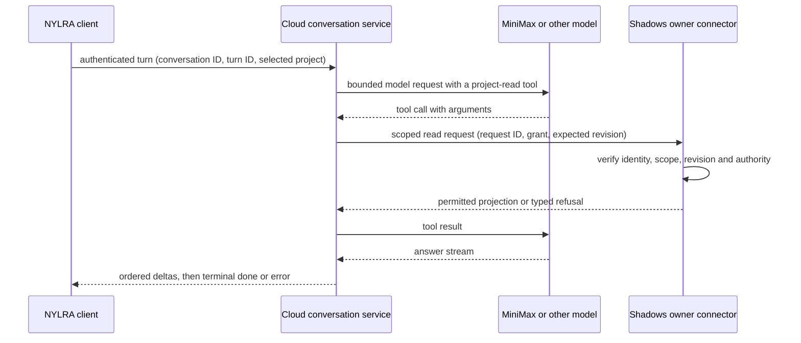

# Linux conversation probe results — 2026-10-12

All content used below was disposable: Shadows project
`63e24e0a-f587-4518-b389-d45a7f93cc4a`, named **Synthetic Lighthouse**,
whose README says it is a cross-project integration fixture. The MiniMax key
was supplied only at runtime and is absent from these repositories.

## Observed

| Scenario | Result | Evidence / meaning |
| --- | --- | --- |
| AI SDK `6.0.303` + `@ai-sdk/openai` `3.0.125`, MiniMax `MiniMax-M3`, mandatory selected-project tool, local Shadows owner available | Completed: two text delta events, fixture name present, one tool execution, two model steps | A real provider call and Shadows owner read crossed the standalone backend probe. The HTTP client saw `done`. |
| Tool requests a different UUID | Refused before any owner HTTP request | `selected-project.test.mjs` verifies the fixed selected-project boundary. |
| Shadows owner unavailable | Failed after tool error; no successful completion | The first live run exposed AI SDK's `tool-error` stream part: it had incorrectly produced `done`. Regression test and `forwardProbePart` now reject it. Repeated live run produced `failed=true`, `completed=false`, zero delta events. |
| NYLRA Linux preview client | SSE parser tests passed; Vite served the preview and approved AYLUL idle asset; native Tauri window rendered AYLUL and displayed a completed local SSE fixture after a button click | That native click used a deterministic fixture, not this real MiniMax probe. See the NYLRA evidence. |
| Native Linux webview origin | Local `tauri://localhost` accepted; unrecognized browser origin refused before conversation | The original Vite-only CORS allowlist returned 403 to the native webview. Regression tests now cover both sides; a native click-through still needs a UI run. |

`npm test` currently exercises nine probe tests. These results cover a
synthetic, same-host exchange; they do not exercise a cloud-to-private-machine
network path, identity, owner grant, state persistence, or cancellation.

## What should become the product boundary

The cloud backend should own provider credentials, SDK integration, turn state,
and stream delivery. Shadows should remain the authority for local project
data and actions. NYLRA should render the stream and collect user decisions;
its UI should not be the connector. A cloud server cannot directly use the
loopback address of a user's machine. The next experiment should have Shadows
establish an authenticated outbound connection (or poll a durable work queue)
and correlate requests and replies by stable IDs. Compare those transports
under disconnect/reconnect before choosing one.

Use a versioned conversation API with explicit `delta`, `done`, `error`, and
`cancelled` terminal semantics; persist only according to an agreed retention
policy. Every tool request needs a selected-project grant and owner-side
recheck. Provider tool arguments and model prose carry no authorization. The
current probe's `GET /api/projects` reads the entire list before local
filtering, which must be replaced by an owner-enforced, scoped projection.

## Reproduce safely

Follow [README.md](README.md). Use a new disposable project and local
`SHADOWS_PROJECT_ID`; run `npm ci && npm test` before `npm start`. Set
`MINIMAX_API_KEY` only in the process environment. On a managed proxy, use
`NODE_USE_ENV_PROXY=1` and the provided proxy/CA environment. Stop Shadows to
reproduce the terminal error case. No production credentials or user projects
are needed.
